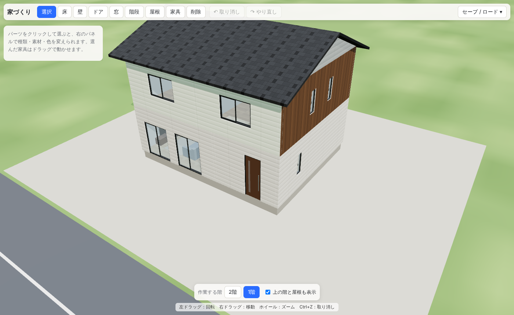

# 家づくりプロトタイプ（v0.1）

[技術構成](./tech-stack.md) の「4. 最小プロトタイプの範囲」を実装したものです。お金の仕組みは [economy.md](./economy.md) にあります。

## できること

| 項目 | 内容 |
|---|---|
| 土地 | 24 × 20 マス（1マス = 910mm）。前面道路つき |
| 床 | ドラッグで四角く張る。フローリング・畳・タイル・カーペットなど。「テラス」にすると屋外のテラス（ウッドデッキ・テラスタイル）になり、接する壁は外壁になる |
| 壁 | マス目の線に沿ってドラッグ。壁で囲まれた部屋の内側が自動で内装、外側が外壁になる（床が壁の外まではみ出していても外壁は外壁のまま。まだ囲まれていない作りかけの壁は、床のある側を内装とする）。家の中の仕切りの壁は両面とも内装になる。高さはふつう（2,900mm）と半分（1,450mm）から選べる。半分の壁には床・屋根は載らず、低い窓しか付けられない |
| 外壁材 | 窯業系サイディング、外壁タイル、塗り壁、木の羽目板、ガルバリウム角波（各6色＋自由な色） |
| ドア | 玄関ドア（片開き・親子）、室内ドア、引き戸。扉の色・枠の色を選べる |
| 窓 | 引き違い窓（大・小）、掃き出し窓、縦すべり出し窓（普通・縦長）、FIX窓、大開口FIX窓、高窓、地窓。サッシの種類（アルミ・アルミ樹脂複合・樹脂・トリプルガラス樹脂・木製）と色を選べる |
| 開口 | 壁に実際に穴が開き、半マス（455mm）単位で位置を決める。重なりや壁からのはみ出しは置けない |
| 階段 | 直階段（幅1マス × 長さ4マス、14段）。2階の床には自動で吹き抜けの穴が開く。手すりは上る向きに見て なし・左・右・両側 から選べる |
| 屋根 | 切妻・寄棟・片流れ・陸屋根。勾配（1〜8寸）、軒の出、棟の向き、屋根材（瓦・スレート・立平・防水シート）と色。置くときは壁の上端の高さでカーソルを読むので、壁の上をなぞればその位置に載る（2階建てなら2階の部屋の上は2階の壁に、1階だけの部分は1階の壁に載る） |
| 妻壁 | 屋根の下の三角の壁（陸屋根はパラペット）の外壁材も別に選べる |
| 家具 | ベッド、ソファ、ダイニング、チェア、テレビボード、デスク、本棚、キッチン、冷蔵庫、ユニットバス、トイレ、観葉植物、ラグ。庭・外にはプール、花壇、花の鉢植え、名前を入れられる表札（門柱・壁付け）（床のない所では地面に置く）。自由な位置・向き |
| 編集 | 選んだパーツの種類・素材・色を右のパネルで変更。削除、取り消し / やり直し |
| 素材 | 外壁17種・内装13種・屋根13種・床14種・木部7種。パネルで見本画像・説明・単価を見ながら選べる（見本は3Dと同じ模様を使う） |
| 表示 | 階ごとの表示切り替え、太陽光と影、素材の模様と凹凸、ガラスの映り込み |
| セーブ | 自動セーブ（再読み込みしても家が残る）＋ 3つのセーブスロット |
| 歩きモード | キャラクターを WASD で動かし、一人称・三人称で家の中を見て回れる（下に詳細） |



最初はサンプルの2階建て（切妻屋根）が建っています。「セーブ / ロード」→「更地にする」で一から建てられます。

## 操作

| 操作 | マウス・キー |
|---|---|
| ツールの持ち替え | 上のボタン、または数字キー 1（選択）2（床）3（壁）4（ドア）5（窓）6（階段）7（屋根）8（家具）9（削除）。持っているツールの数字キーかボタンをもう一度押すか、Esc で選択（手ぶら）に戻る |
| 置く階 | 選ぶ必要はなく、マウスで指した場所から自動で決まる。地面なら1階、2階の床の上なら2階、1階の壁の上なら2階。床は地面の上か、下の階の壁の上に張れる。屋根は範囲の下にあるいちばん上の階の壁に載る |
| 視点の移動 | WASD / 矢印キーで前後左右（Shift で速く）。マウスなら選択ツール：右ドラッグ ／ 建てるツール・削除ツール：中ドラッグか Shift＋右ドラッグ。地面と平行に動く |
| 視点の回転 | Q / E で左右に回る。マウスなら選択ツール：左ドラッグ ／ 建てるツール・削除ツール：右ドラッグ |
| ズーム | ホイール（マウスのある場所へ寄る） |
| 向きを変える | R（階段・家具） |
| 家具を動かす | 選んでからドラッグ、または矢印キーで5cmずつ（家具を選んでいる間は矢印キーでカメラは動かない） |
| 削除 | Delete キー、または削除ツールでクリック。削除ツールでドラッグすると範囲のパーツをまとめて選び（「まとめて選ぶ」に切り替わる）、クリックで選ぶ・外す、「まとめて削除」か Delete で一度に消す（Ctrl+Z 1回で戻る）。削除ツールの視点の回転は右ドラッグ |
| 取り消し / やり直し | Ctrl+Z / Ctrl+Y（Mac は ⌘） |

## 歩きモード（プレイヤー）

上の「歩いてみる」ボタンか Tab キーで、建てた家の中を自分のキャラクターで歩けます。もう一度 Tab で建築モードに戻ります。

| キー | 操作 |
|---|---|
| W / S | 前へ / 後ろへ |
| A / D | 左へ / 右へ（横歩き） |
| Shift | 押している間は走る |
| Space | ジャンプ。開いた窓の前では窓を乗り越える |
| C | しゃがむ / 立つ（切り替え） |
| Q | 一人称 ⇄ 三人称 |
| R | カメラを背中側に戻す（階段・家具を持っているときは向きを変える） |
| F / E | 近くのドア・窓を開ける / 閉める（画面のボタンでも可） |
| マウス | 画面をクリックすると視点操作（Esc で解除）。ドラッグでも回せる |
| ホイール | 三人称のカメラの距離 |
| 2〜9 | 建てるツールを持つ（下の「歩きながら建てる」） |
| Tab | 建築モードに戻る |

### 歩きながら建てる

歩きモードのまま、上のツールボタンか数字キー 2〜9 で床・壁・ドア・窓・階段・屋根・家具・削除のツールを持てます。持っている間は次のように操作します。

- 左クリック（床・壁・屋根はドラッグ）で、マウスのある場所に置く。プレビューは歩いて動いても追従する
- 右ドラッグで見回す。WASD で歩くのはそのまま
- 置く階は、マウスで指した場所（地面・床・壁の上）から自動で決まる
- 階段・家具の向きは R、取り消しは Ctrl+Z
- 1 か Esc で手ぶらに戻る（いつもの歩きモード）

- 壁は通り抜けられません。ドアは閉まっていると通れず、開けると通れます。
- ドアに近づくと足もとに光の輪が出て扉がほんのり光り、画面に「F ドアを開ける」ボタンが出ます。開け閉めすると扉が蝶番で回り（引き戸は横にすべり）、ラッチ・きしみ・閉まる音が鳴ります。扉はプレイヤーから遠ざかる向きに開きます。
- 窓も F / E で開け閉めできます。引き違い窓は左の障子が右へすべり、縦すべり出し窓は外へ押し出して開きます（FIX窓・高窓は開きません）。
- 掃き出し窓は開ければ歩いて出入りできます。腰高の窓は、開けて前に立つと「Space 窓から出る」が出て、窓台に手をかけてよじ登り、枠の上にしゃがんでから反対側へ降ります。外から1階の窓へよじ登って入ることもできます。
- 2階の窓から出るときは、枠の上で外側の縁へにじり出て下をのぞいてから飛び降ります。着地はひざを深く曲げ、土ぼこりと音が出てカメラが少し揺れます。
- 小さい引き違い窓と縦すべり出し窓は狭くて通れません（画面にそう出ます）。2階の窓には外から届きません。窓の出入りの段取りは `src/building/climb.ts` にあります。
- キャラクターは丸みのある体に、腰・ひざ・足首・肩・ひじ・首の関節があります。足は地面に付くように角度を計算し（IK）、歩幅と足を運ぶ速さを合わせているので足がすべりません。歩き出し・止まり・向きを変えるときはなめらかに加減速し、曲がるときは体を内側へ傾けます。立ち止まると呼吸で胸が動き、頭はカメラの向きへ少し振り向きます。
- しゃがむとひざを曲げて腰を落とし、上体を前へ倒して腕をひざの上に置きます。しゃがんだまま歩くと小さな歩幅でそろそろ進みます。
- 基礎の高さ（500mm）は段差として上がれます。階段で2階へ上がれ、2階の吹き抜けから落ちると1階に着地します。階段の手すりは横から通り抜けられません（階段の高いほうの下はくぐれます）。
- 家具にはぶつかります（ラグは踏めます）。
- 屋根には当たり判定があります。屋根の上に乗って斜面を歩け、ジャンプすると屋根の下面（1階では2階の床）で頭がつかえ、屋根の斜面を横からすり抜けることもありません。
- 三人称のカメラは壁や屋根に埋もれないよう手前に寄ります。
- 当たり判定の計算は `src/building/walk.ts` にあり、テストがあります。キャラクターの体と動きは `src/world/Avatar.tsx` です。

## スマホ・タブレットでの操作

指で操作する端末（`pointer: coarse`）では自動でスマホ用の画面になります。パソコンで試すときは URL に `?touch=1` を付けます。

| 場面 | 操作 |
| --- | --- |
| 建築モード（選択） | タップで選ぶ、1本指でなぞって回す、2本指で移動・つまんでズーム、右のボタンで回る・寄る |
| 建築モード（建てるツール） | 床・壁・屋根は指でなぞる、ドア・窓・階段・家具はタップ。2本目の指が触れたら置くのをやめてカメラ操作になる |
| 歩きモード | 左下のスティックで歩く（端まで倒すと走る）、画面をなぞって見回す、2本指でつまんでカメラの距離、右下のボタンでジャンプ（運転中はブレーキ） |
| 歩きながら建てる | 1本指で置く、2本指で見回す |

スマホでは上のバーを出さず、左上にモード切り替え・取り消し・セーブと所持金だけを小さく置きます。建てる道具は右上のオレンジの「建てる」ボタンから開く建築メニューで、アイコン付きのカードから選び、その下で種類・素材・色を選びます。選んだパーツのパネルは画面下の引き出しに出ます。

歩いているときは画面をすっきりさせるため、スティック・ジャンプと、左上の ☰ と所持金だけを出します。建築に戻る・道具を持って建てる・町の地図・視点の切り替え・取り消し・セーブは ☰ の中に入れています。道具を持ったときだけ右上に道具ボタンと操作の説明が出ます。

## 一軒建てる手順

1. 「セーブ / ロード」→「更地にする」を2回押して空き地にする
2. 「床」で地面の上をドラッグして1階の床を張る
3. 「壁」で床の外周をなぞる
4. 「ドア」「窓」で壁をクリックして付ける
5. 「階段」で1階の床に階段を置く
6. 「床」で1階の壁の上からドラッグして2階の床を張り、その上に壁を立てる（階段の上は自動で穴が開く）
7. 「屋根」で範囲をドラッグする（いちばん上の階の壁に載る）
8. 「選択」でパーツを選び、外壁材や屋根の形・色を整える
9. 「家具」で家具を置く

## コードの置き方

```
src/
  building/   パーツの型、寸法、配置ルール、屋根の形の計算、サンプルの家（描画に依存しない）
  catalog/    素材・窓とドア・家具のカタログ（JSON）。種類を増やすときはここにデータを足す
  world/      3D描画（地面、光、壁・床・屋根などの形づくり、配置操作）
  ui/         メニューとパネル（React）。スマホ用は TouchControls.tsx と mobile.css
  state/      ゲーム状態と取り消し履歴（Zustand）
  save/       ブラウザ内へのセーブとロード
```

配置の可否（壁の重なり、窓が壁に収まるか、階段の位置など）は `src/building/rules.ts` にまとめ、描画から切り離しています。将来サーバーで同じ判定をするときにそのまま移せます。

## 次にやること（候補）

- 部屋ツール（ドラッグで床と壁を一度に）、間取りテンプレート
- 壁を低く表示する切り替え（室内を見やすくする）
- 3階建て・吹き抜け・バルコニー・外構
